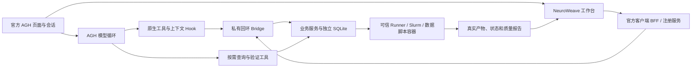

# AGH 架构与真实执行链

## 分工

AGH 管理会话、Agnes 模型调用、工具调度、上下文压缩和原生日志。NeuroWeave 保留方法契约、目标与方案版本、数据选择、参数、资源、预检、执行和产物登记。普通平台的协调者及功能 Agent 模型循环在赛事模式关闭，不调用第二套模型规划器。

官方 AGH 固定提交见 [lock.json](../../integrations/agh/lock.json)；Web 空会话与记录管理适配通过官方 SDK 工作。插件使用官方扩展、TypeBox 契约、服务和客户端描述文件；工作台渲染于 AGH Shadow DOM，使用宿主 React 并隔离样式。

## 规划与会话绑定

仅规划部署不加载科学软件或探测 Slurm，保留所有登记方法的结构契约。方法与 Pipeline 的选择、参数编辑和连接检查按契约完成；缺失数据根不阻止启动或生成草稿。实际运行能力明确为不可用，后端拒绝执行，并在接入真实环境后重新预检。

AGH session.key 对应独立业务 conversation，业务 SQLite 保存该会话的数据、输出、目标、路线、流程和运行。上下文 Hook 通过官方 SDK 只读获取用户原话，用于验证输入存在/缺失声明，不控制或改写原生会话。

模型先保存目标，查询方法输出端口，调用 `nw_method_routes` 得到 route_id，再调用 `nw_prepare_workflow` 保存草稿。后端恢复真实方法图和默认参数；用户在卡片选择输入和资源。生成草稿不运行计算。

目标编辑由 AGH 对话重新规划，保留同一目标和兼容的配置。工作台没有助手/仅聊天开关，也没有对话右侧方案面板；目标和方案在工作台检查。任务交付或计算完成不自动归档用户目标。

## 执行与授权

比赛 profile 使用 `approvals.mode: off`，配置、参数和执行不追加审批。用户点击工作台运行等按钮时，受信任 UI 服务冻结具体请求、版本、输入指纹、资源和输出，并持久化 `user_requested=true`。

`nw.action.submit` 是官方注册的 effect 服务，返回排队回执；后端完成校验后提交 Runner / Slurm。模型可通过原生 `nw_apply_action` 执行已由用户点击授权的冻结动作，但模型准备方案不会产生执行权限。

服务调用与原生模型工具调用分别记录；`agh-service:action_...` 是服务关联标识，不是原生 toolUseId。动作派发前记录 dispatching，完成后保存结果；已完成重放返回原结果，未知提交只查询，不自动重复。

科学运行固定 Slurm + 按样本运行。共享 Worker 与当前发布提交一致，数据和 Python 必须在计算节点可见；实例使用专用数据库和输出根。

## 监控与验证

工作台发现运行记录并读取实际 Runner 的状态增量和日志，监控不依赖模型回复。模型可在同一会话调用 `nw_read_workflow`、`nw_read_run` 和 `nw_verify_run` 查询与验证。

当前未实现计算终态自动触发 AGH 后续推理。比赛材料若要证明规划、能力调用、反馈处理和验证连续发生，应保留同一任务的真实查询及核验记录，不能用工作台轮询代替模型读取结果的证据。

`nw_verify_run` 检查成功运行的产物存在与记录哈希；ROI 统计另用相同样本输入进行独立数值核验。其他方法的科研检查根据自己的质量报告提供，不将哈希一致解释为普遍科研或临床有效。

## 部署边界

Bridge 只监听回环，要求私有 Bearer 凭据与关联头，拒绝浏览器直接访问完整业务 API。AGH Host / Origin 校验保留，通过 SSH 转发访问。当前部署面向单一受信任操作者，不声称多租户 OS 隔离。

插件能力上限为 tools / hooks / services / slots / ui / resources。通用代码、网络、文件、subagent 等内置执行能力未获准；自动压缩保留。专业数据脚本在已有容器环境中执行，不能绕过冻结动作或运行按钮。
